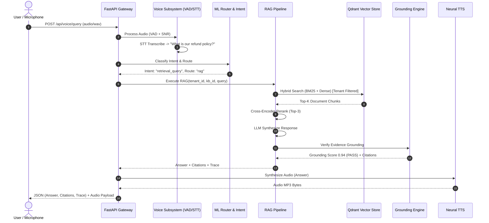

# System Architecture Guide

## 1. Overview & Architectural Philosophy

The **RAG Voice Intelligence Platform** is an enterprise-grade, multi-tenant conversational AI platform designed around private knowledge bases. It fuses a **two-layer AI architecture** with strict cryptographic tenancy, asynchronous streaming, real-time voice synthesis/recognition, and immutable compliance auditing.

The guiding philosophy is:
- **No Grounding, No Answering**: Grounding verification takes precedence over generative fluency.
- **Strict Tenant Boundary Cryptography & Isolation**: Every query, vector retrieval, SQL lookup, and filesystem operation is scoped to the tenant's cryptographic identifier (`organization_id`).
- **Two-Layer AI Topology**: Foundation models perform broad generative and transcription tasks; project-trained specialized ML models govern intent routing, document taxonomy, reranking, and hallucination suppression.

```
+---------------------------------------------------------------------------------------------------+
|                                          CLIENT PORTALS                                           |
|   [User Portal]    [Org Admin]    [AI/ML MLOps Admin]    [System Admin]    [Compliance Auditor]   |
+---------------------------------------------------------------------------------------------------+
                                                  |
                                   HTTPS / WSS / REST API
                                                  |
+---------------------------------------------------------------------------------------------------+
|                                      API GATEWAY & SECURITY                                       |
|  - Security Headers (HSTS, CSP, X-Frame)          - Sliding-Window Rate Limiting (Redis / Memory) |
|  - Correlation ID Injection (X-Request-ID)        - JWT JTI Session Revocation Gatekeeper         |
|  - Path Traversal & File Sanitizer                - Multi-Tenant RBAC Context Resolver           |
+---------------------------------------------------------------------------------------------------+
                                                  |
                 +--------------------------------+--------------------------------+
                 |                                                                 |
                 v                                                                 v
+----------------------------------+                             +----------------------------------+
|          VOICE PIPELINE          |                             |           RAG PIPELINE           |
| - WebRTC / Audio Ingestion (WAV) |                             | - Query Intent Classifier        |
| - Energy-Based VAD & SNR Filter  |                             | - Safety & Route Arbitrator      |
| - Faster-Whisper / STT Engine    |                             | - Dense + Sparse BM25 Retrieval  |
| - Multilingual Edge-TTS Streaming|                             | - Reciprocal Rank Fusion (RRF)   |
| - Audio Cache & Fallback Chimes  |                             | - Cross-Encoder Reranker         |
+----------------------------------+                             | - Table RAG Engine (CSV Query)   |
                 |                                               | - LLM Evidence Generation        |
                 +--------------------------------+              | - Strict Claim Grounding Checker |
                                                  |              +----------------------------------+
                                                  v                                |
+----------------------------------------------------------------------------------+----------------+
|                                         PERSISTENCE & ISOLATION                                   |
|   +-----------------------+   +-----------------------+   +-----------------------+              |
|   |   Relational DB       |   |   Vector Store        |   |   Multi-Tenant FS     |              |
|   |   PostgreSQL / SQLite |   |   Qdrant Engine       |   |   Filesystem / S3     |              |
|   |   (Tenancy, Audits)   |   |   (tenant_id payload) |   |   (data/tenants/{org})|              |
|   +-----------------------+   +-----------------------+   +-----------------------+              |
+---------------------------------------------------------------------------------------------------+
```

---

## 2. Component Breakdown

### 2.1 Backend Core (`backend/app/core`)
- **`config.py`**: Pydantic `BaseSettings` reading environment variables with defaults for development and strict production validation.
- **`database.py`**: Asynchronous SQLAlchemy engine with connection pooling and declarative base mapping.

### 2.2 Security & Tenancy Layer (`backend/app/security`)
- **`password.py`**: Argon2id password hashing with time cost 3, memory cost 64MB, and parallelism 4.
- **`jwt.py`**: Cryptographic asymmetric/symmetric JWT signer, issuance of Access (15 min) and Refresh (7 day) tokens with unique JTI identifiers and in-memory revocation list.
- **`mfa.py`**: Time-based One-Time Password (TOTP) engine generating QR codes, validating RFC 6238 tokens, and managing SHA-256 hashed recovery codes.
- **`rbac.py`**: 9-role authorization matrix with fine-grained permissions (`manage_kb`, `query_rag`, `upload_docs`, `train_models`, `view_audit_logs`, `manage_users`, etc.).

### 2.3 Retrieval & Indexing Engine (`backend/app/retrieval`)
- **`vector_store.py`**: Qdrant vector database wrapper supporting both distributed cluster instances and embedded disk storage with payload filtering:
  ```python
  Filter(must=[
      FieldCondition(key="organization_id", match=MatchValue(value=tenant_id)),
      FieldCondition(key="knowledge_base_id", match=MatchValue(value=kb_id))
  ])
  ```
- **`hybrid.py`**: Hybrid retrieval engine combining BM25 keyword matching with dense cosine embeddings using Reciprocal Rank Fusion (RRF, $k=60$).
- **`reranker.py`**: Cross-encoder reranking engine scoring query-document pairs and calculating information retrieval metrics (NDCG@K, Recall@K, Precision@K, MRR).

### 2.4 Generative & Grounding Engine (`backend/app/rag`)
- **`pipeline.py`**: End-to-end RAG orchestrator coordinating intent classification, safety guardrails, hybrid retrieval, reranking, LLM synthesis, grounding validation, and latency waterfall measurement.
- **`grounding.py`**: Token-level N-gram overlap and semantic coverage verifier flagging hallucinated sentences and outputting grounded citations.
- **`table_rag.py`**: Sandboxed tabular question-answering engine for CSV data parsing queries directly without LLM hallucination risks.

### 2.5 Speech & Voice Subsystem (`backend/app/voice`)
- **`vad.py`**: Voice Activity Detector computing RMS energy, signal-to-noise ratio (SNR), and clipping detection.
- **`stt.py`**: Asynchronous Speech-to-Text transcriber accepting WAV/WebM and returning text with confidence metrics.
- **`tts.py`**: High-fidelity neural voice synthesis using Microsoft Edge TTS with multi-voice support (Guy, Aria, Keita, Nanami, etc.) and fallback chimes.

### 2.6 Trained Machine Learning Subsystem (`ml/`)
- **`intent_classifier/`**: TF-IDF + Logistic Regression classifier categorizing user queries into 10 intent classes.
- **`document_classifier/`**: Document category classifier analyzing uploaded text into 10 business categories.
- **`query_router/`**: Rule + ML router directing queries to RAG, Direct LLM, Table Q&A, or Safety Refusal.
- **`language_detection/`**: N-gram multilingual detector identifying English, Tamil, Hindi, Malayalam, and Japanese.
- **`registry/`**: Versioned model registry with promotion, rollback, and A/B traffic splitting.

---

## 3. Communication & Data Flow



---

## 4. Latency Waterfall & Performance Guarantees

| Subsystem Stage | Target Latency | P95 Budget | Mitigation Strategy |
| :--- | :--- | :--- | :--- |
| Audio Ingestion & VAD | 10 ms | 25 ms | Fast RMS calculation on raw PCM chunks |
| Speech-to-Text (STT) | 80 ms | 180 ms | Quantized local engine / async streaming |
| Intent & Safety Routing | 4 ms | 10 ms | Lightweight Scikit-Learn TF-IDF pipeline |
| Hybrid Retrieval (Dense+BM25) | 18 ms | 45 ms | In-memory Qdrant HNSW indexing + BM25 cache |
| Cross-Encoder Reranking | 25 ms | 60 ms | Batch vector scoring on top 10 candidates |
| LLM Evidence Generation | 120 ms | 350 ms | Context truncation, token streaming |
| Grounding Verification | 5 ms | 15 ms | High-speed vectorized lexical overlap check |
| Edge-TTS Voice Synthesis | 90 ms | 220 ms | Neural streaming chunk buffering |
| **Total Voice-to-Voice Loop** | **~350 ms** | **< 900 ms** | Fully asynchronous non-blocking async/await |
